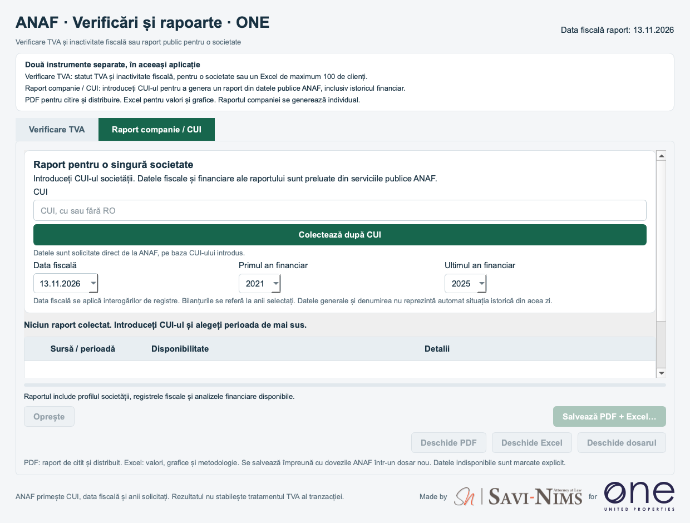

# Verificare TVA și raport companie · ONE · 2.0.2.1

Made by **SAVI-NIMS** for **ONE United Properties**

[Română](#română) · [English](#english) · [Instalare / Installation](INSTALLARE.md)

| Platformă / Platform | Descărcare / Download |
|---|---|
| Windows 10/11 x64 | [Windows ZIP](https://github.com/victor-savinims-legal/anaf-vat-checker-one-downloads/releases/latest/download/VerificareTVA-ONE-Windows-x64.zip) |
| Mac Apple Silicon, macOS 13+ | [Mac DMG](https://github.com/victor-savinims-legal/anaf-vat-checker-one-downloads/releases/latest/download/VerificareTVA-ONE-Mac-AppleSilicon.dmg) |
| Șablon Excel / Excel template | [Model_Import_Companii.xlsx](https://github.com/victor-savinims-legal/anaf-vat-checker-one-downloads/releases/latest/download/Model_Import_Companii.xlsx) |

[Pagina permanentă / Latest release](https://github.com/victor-savinims-legal/anaf-vat-checker-one-downloads/releases/latest)

Ediția ONE are un link separat destinat echipei. Linkul este public și poate fi redistribuit. / ONE uses a separate link intended for the team. It is public and can be redistributed.

## Română

**Actualizare 2.0.2.1: identificare exclusiv prin CUI.** Căutarea după denumirea societății a fost eliminată din ambele secțiuni, împreună cu serviciul extern de identificare.

- **Verificare TVA:** introduceți un CUI sau încărcați un Excel cu **Denumire societate** și **CUI**, maximum 100 de companii. Primiți un raport colorat privind TVA și inactivitatea fiscală, cu **COMENTARII** și dovezi JSON. Denumirea din Excel este păstrată pentru comparația cu datele ANAF.
- **Raport companie / CUI:** introduceți CUI-ul unei societăți pentru date publice ANAF, registre fiscale și RO e-Factura, bilanțuri multianuale, grafice și 15 explicații. Export **PDF + Excel + dovezi JSON**, cu antet SAVI-NIMS. Raportul detaliat se generează individual.

Descărcarea este gratuită, fără cont GitHub. Interfața este în română. Python și Excel nu trebuie instalate pentru rularea aplicației. Este necesar internet pentru ANAF.

**Windows:** extrageți complet ZIP-ul, rulați `Test instalare.cmd`, apoi `VerificareTVA-ONE.exe`. Păstrați dosarul `_internal` alături de executabil. **Mac:** deschideți DMG-ul și copiați `VerificareTVA-ONE.app` în Applications. Numai Apple Silicon.

**Avertizări:** Windows nu are semnare comercială, Mac nu este notarizat Apple. Dacă aveți încredere în proveniență, pentru avertizarea SmartScreen de aplicație nerecunoscută puteți folosi **More info → Run anyway**, dacă opțiunea este disponibilă. Pentru blocarea dezvoltatorului neverificat pe Mac: **System Settings → Privacy & Security → Open Anyway**, după prima încercare de deschidere. Consultați [ghidul complet RO/EN](INSTALLARE.md). Nu ignorați alerte de malware sau fișiere deteriorate. Dacă politica organizației blochează aplicația, consultați IT. Nu dezactivați protecțiile sistemului.

Excelul original rămâne nemodificat. Solicitările merg direct la ANAF, cu CUI, data fiscală și anii financiari solicitați. Datele lipsă sunt marcate explicit. Aplicația nu interoghează direct ONRC și nu stabilește tratamentul TVA al tranzacției.

## English

**Update 2.0.2.1: CUI-only identification.** Company-name search and the external identity-discovery service have been removed from both workflows.

- **VAT check:** enter a CUI or upload an Excel file with **Denumire societate** (company name) and **CUI**, up to 100 companies. Export colour-coded VAT/fiscal-inactivity results, comments and JSON evidence. Excel company names are retained for comparison with ANAF.
- **Company / CUI report:** enter one company's CUI for public ANAF information, fiscal and RO e-Factura registers, multiyear financial statements, charts and 15 plain-language explanations. Export **PDF + Excel + JSON evidence**, with SAVI-NIMS report branding. Detailed reports are generated individually.

Free download, no GitHub account required. Romanian interface. Python and Excel are not required to run the app. ANAF queries require internet.

**Windows:** extract the entire ZIP, run `Test instalare.cmd`, then `VerificareTVA-ONE.exe`. Keep `_internal` beside the executable. **Mac:** open the DMG and copy `VerificareTVA-ONE.app` to Applications. Apple Silicon only.

**Security warnings:** no commercial Windows signature or Apple notarization. If you trust the source, an unrecognized-app SmartScreen warning may offer **More info → Run anyway**. For a Mac launch blocked because the developer is unverified, use **System Settings → Privacy & Security → Open Anyway**, after attempting to open the app. See the [full bilingual guide](INSTALLARE.md). Do not dismiss malware or damaged-file alerts. Contact IT if organizational policy blocks the app. Do not disable system protection.

The original Excel stays unchanged. Requests go directly to ANAF with the CUI, fiscal date and requested financial years. Missing data remains explicitly unavailable. The app does not directly query ONRC or determine transaction VAT treatment.

## Distribuție / Distribution

Linkurile indică ultima versiune publicată. Actualizarea aplicației este manuală. / Links point to the latest published version. App updates are manual.

Sursa rămâne privată. Acest repository conține numai documentație și descărcări. Arhivele GitHub „Source code” conțin doar documentația. / Source remains private. This repository contains documentation and downloads only. GitHub's automatic “Source code” archives contain documentation only.

[SHA256SUMS.txt](https://github.com/victor-savinims-legal/anaf-vat-checker-one-downloads/releases/latest/download/SHA256SUMS.txt) · [VALIDATION.json](https://github.com/victor-savinims-legal/anaf-vat-checker-one-downloads/releases/latest/download/VALIDATION.json)
