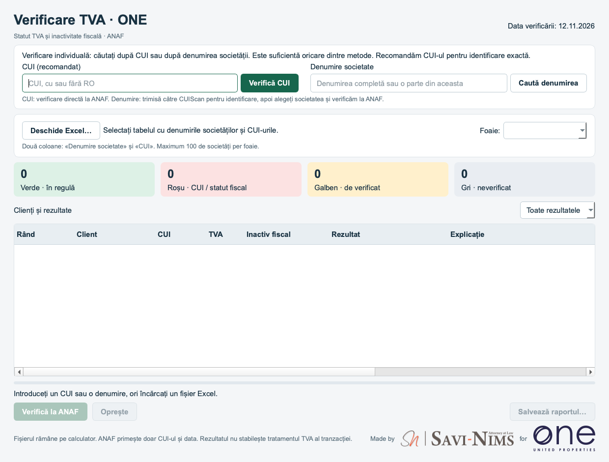

# Verificare TVA · ONE

**Ediția ONE 1.0.4.1 · Made by SAVI-NIMS for ONE United Properties**

[Descarcă ultima versiune ONE / Download latest ONE edition](https://github.com/victor-savinims-legal/anaf-vat-checker-one-downloads/releases/latest)

## Română

Aplicație pentru verificarea statutului TVA și a inactivității fiscale a societăților românești, direct la ANAF. Ediția ONE păstrează funcțiile versiunii 1.0.4 și adaugă identitatea vizuală SAVI-NIMS și One United Properties.

- **CUI (recomandat):** verificare individuală directă la ANAF.
- **Denumire societate:** identificare prin CUIScan, alegerea explicită a firmei, apoi verificare la ANAF.
- **Excel:** import din două coloane, `Denumire societate` și `CUI`, până la 100 de rânduri.
- **Raport:** rezultate colorate, comentarii privind CUI lipsă și diferențele de denumire, export Excel și dovezi JSON.

Este destinată distribuirii către echipa ONE. **Linkul este public, fără cont GitHub**, și poate fi redistribuit. Nu încărcați aici fișierele clienților. Repository-ul conține doar documentație și pachetele distribuibile. Codul sursă rămâne privat.

| Descărcare | Platformă |
|---|---|
| [Windows ZIP](https://github.com/victor-savinims-legal/anaf-vat-checker-one-downloads/releases/latest/download/VerificareTVA-ONE-Windows-x64.zip) | Windows x64 |
| [Mac DMG](https://github.com/victor-savinims-legal/anaf-vat-checker-one-downloads/releases/latest/download/VerificareTVA-ONE-Mac-AppleSilicon.dmg) | Mac Apple Silicon |
| [Șablon Excel](https://github.com/victor-savinims-legal/anaf-vat-checker-one-downloads/releases/latest/download/Model_Import_Companii.xlsx) | Două coloane, fără date de clienți |

**Instalare:** pe Windows, extrageți complet ZIP-ul și deschideți `VerificareTVA-ONE.exe`, păstrând dosarul `_internal`. Pe Mac, copiați `VerificareTVA-ONE.app` din DMG în Applications. Ediția ONE poate fi instalată alături de aplicația generală `VerificareTVA`. Actualizarea este manuală.

**Windows nu este semnat comercial, iar Mac nu este notarizat Apple.** Consultați [instrucțiunile RO/EN de instalare, avertizările de securitate și verificarea IT](INSTALLARE.md). Nu dezactivați protecțiile sistemului. Politicile organizației pot necesita intervenția IT.

Această ediție are un link separat. [Versiunea generală 1.0.4](https://github.com/victor-savinims-legal/anaf-vat-checker-downloads/releases/tag/v1.0.4) rămâne disponibilă la linkul ei existent.

## English

The **ONE edition 1.0.4.1** checks Romanian companies' VAT registration and fiscal inactivity directly with ANAF. It retains the features of version 1.0.4 and adds SAVI-NIMS and One United Properties branding.

Search by **CUI (recommended)** or company name, or import an Excel file with `Denumire societate` and `CUI` columns, up to 100 rows. Name lookup uses CUIScan to identify candidates. You must choose the company before its CUI is checked with ANAF. Results can be exported with comments and supporting JSON evidence.

This separate edition is intended for the ONE team. **Downloads are public and require no GitHub account.** The link can be forwarded. Do not upload client files to this repository. The source code remains private.

Use the Windows, Mac or Excel links above. Extract the complete Windows ZIP before running `VerificareTVA-ONE.exe`. On Mac, copy `VerificareTVA-ONE.app` into Applications. Both editions can coexist. **No commercial Windows signature or Apple notarization is included.** Read the [bilingual installation and IT instructions](INSTALLARE.md) before installation.

The result covers VAT registration and fiscal inactivity at the indicated date. It does not determine a transaction's VAT treatment. The public 1.0.4 edition and its download link remain separate.

