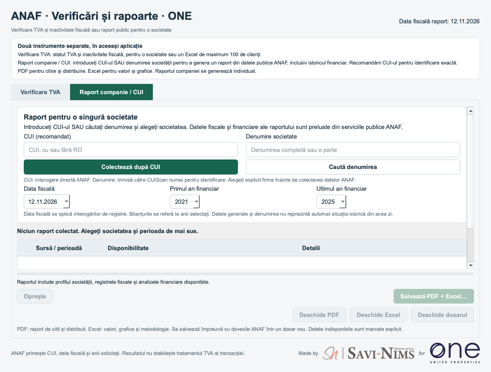

# Verificare TVA · ONE

Made by **SAVI-NIMS** for **ONE United Properties**

[Română](#română) · [English](#english) · [Installation / Instalare](INSTALLARE.md)

| Platform / Platformă | Download / Descarcă |
|---|---|
| Windows 10/11 x64 | [Windows ZIP](https://github.com/victor-savinims-legal/anaf-vat-checker-one-downloads/releases/latest/download/VerificareTVA-ONE-Windows-x64.zip) |
| Mac Apple Silicon, macOS 13+ | [Mac DMG](https://github.com/victor-savinims-legal/anaf-vat-checker-one-downloads/releases/latest/download/VerificareTVA-ONE-Mac-AppleSilicon.dmg) |
| Excel template / Șablon Excel | [Model_Import_Companii.xlsx](https://github.com/victor-savinims-legal/anaf-vat-checker-one-downloads/releases/latest/download/Model_Import_Companii.xlsx) |

[Latest release / Ultima versiune](https://github.com/victor-savinims-legal/anaf-vat-checker-one-downloads/releases/latest)

## Română

Ediția ONE, cu aceleași funcții ca versiunea generală 2.0.1. Link separat destinat distribuirii interne. Este public și poate fi redistribuit.

**Funcții incluse:** două instrumente distincte: **Verificare TVA** pentru verificarea fiscală rapidă și **Raport companie / CUI** pentru un raport detaliat din datele publice ANAF. Introduceți **CUI-ul (recomandat)** sau căutați denumirea și alegeți explicit societatea. Raportul include profilul companiei, registre fiscale, bilanțuri multianuale, grafice, explicații ușor de înțeles și export **PDF + Excel + dovezi JSON**. [Instrucțiuni](INSTALLARE.md#română).

Aplicație desktop pentru verificarea **înregistrării TVA și a inactivității fiscale ANAF** a companiilor românești. Încărcați un Excel cu **Denumire societate** și **CUI**, maximum 100 de companii per foaie. Exportați un raport colorat, cu **COMENTARII** pentru date lipsă și diferențe de denumire.

Descărcarea este gratuită, fără cont GitHub. Interfața aplicației este în română. Nu trebuie instalate Python sau Excel pentru rularea aplicației.

**Windows:** extrageți complet ZIP-ul, rulați `Test instalare.cmd`, apoi `VerificareTVA-ONE.exe`. Păstrați dosarul `_internal` alături de executabil. **Mac:** deschideți DMG-ul și copiați `VerificareTVA-ONE.app` în Applications. Pachetul este doar pentru Apple Silicon.

**Avertizări de securitate:** versiunea nu are semnare comercială Windows sau notarizare Apple. Pentru avertizarea SmartScreen de aplicație nerecunoscută: **More info → Run anyway**, numai dacă aveți încredere în sursă și opțiunea este disponibilă. Pe Mac, după blocarea dezvoltatorului neverificat: **System Settings → Privacy & Security → Open Anyway**, dacă alegeți să autorizați aplicația.

**Nu ignorați alertele de malware sau fișiere deteriorate.** Dacă Smart App Control sau politica organizației blochează rularea, consultați IT. Nu dezactivați protecțiile sistemului. [Instrucțiuni complete în română](https://github.com/victor-savinims-legal/anaf-vat-checker-one-downloads/blob/main/INSTALLARE.md#română).

Excelul original rămâne nemodificat. La ANAF ajung CUI, data fiscală și anii bilanțurilor solicitați. Fluxul TVA salvează `Raport_TVA.xlsx` și dovezi JSON. Raportul detaliat salvează `Raport_Companie.pdf`, `Raport_Companie.xlsx` și dovezi JSON. Denumirea este transmisă CUIScan numai când alegeți această metodă de identificare. Datele lipsă sunt marcate explicit. Aplicația nu face verificare directă ONRC și nu stabilește tratamentul TVA al tranzacției.

## English

ONE edition, with the same features as general version 2.0.1. Separate link intended for internal sharing. It is public and can be redistributed.

**Included features:** two distinct workflows: **Verificare TVA** for quick fiscal checks and **Raport companie / CUI** for a detailed report using public ANAF data. Enter the **CUI (recommended)** or search by name and explicitly select the company. The report includes a company profile, fiscal registers, multiyear financial data, charts, plain-language explanations and **PDF + Excel + JSON evidence** export. [Instructions](INSTALLARE.md#english).

A desktop app that checks **ANAF VAT registration and fiscal inactivity** for Romanian companies. Upload an Excel file with **Denumire societate** (company name) and **CUI** (Romanian tax identifier), for up to 100 companies per sheet. Export a colour-coded report with **COMENTARII** (comments) for missing information and company-name differences.

Free download, with no GitHub account required. The app interface is in Romanian. Python and Excel are not required to run it.

**Windows:** extract the whole ZIP, run `Test instalare.cmd`, then open `VerificareTVA-ONE.exe`. Keep the `_internal` folder beside the executable. **Mac:** open the DMG and copy `VerificareTVA-ONE.app` into Applications. This package is for Apple Silicon only.

**Security warnings:** this release has no commercial Windows signing or Apple notarization. For an unrecognized-app SmartScreen warning: **More info → Run anyway**, only if you trust the source and the option is available. On Mac, after a launch blocked because the developer is unverified: **System Settings → Privacy & Security → Open Anyway**, if you choose to authorize the app.

**Do not dismiss malware or damaged-file alerts.** If Smart App Control or an organization policy blocks execution, contact IT. Do not disable system protection. [Full English instructions](https://github.com/victor-savinims-legal/anaf-vat-checker-one-downloads/blob/main/INSTALLARE.md#english).

The original Excel stays unchanged. ANAF receives the CUI, fiscal date and requested financial years. VAT checks save `Raport_TVA.xlsx` and JSON evidence. Detailed reports save `Raport_Companie.pdf`, `Raport_Companie.xlsx` and JSON evidence. Names go to CUIScan only when that identification method is used. Missing data is explicitly marked. The app does not directly query ONRC or determine a transaction’s VAT treatment.

## Releases / Versiuni

Linkurile permanente indică ultima versiune publicată. Aplicația nu se actualizează automat. / Permanent links point to the latest published release. The app does not update automatically.

Codul sursă rămâne privat. Acest repository conține documentație și descărcări. Arhivele „Source code” generate de GitHub conțin doar documentația, nu aplicația. / The app source remains private. This repository contains documentation and downloads. GitHub's automatic “Source code” archives contain documentation, not the app.

[SHA256SUMS.txt](https://github.com/victor-savinims-legal/anaf-vat-checker-one-downloads/releases/latest/download/SHA256SUMS.txt) · [VALIDATION.json](https://github.com/victor-savinims-legal/anaf-vat-checker-one-downloads/releases/latest/download/VALIDATION.json)

Ghidul detaliat include documentația oficială Microsoft și Apple. / The detailed guide links to official Microsoft and Apple guidance.
